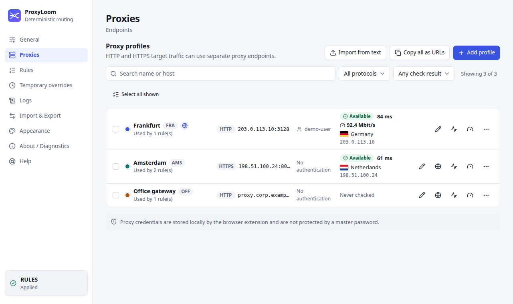
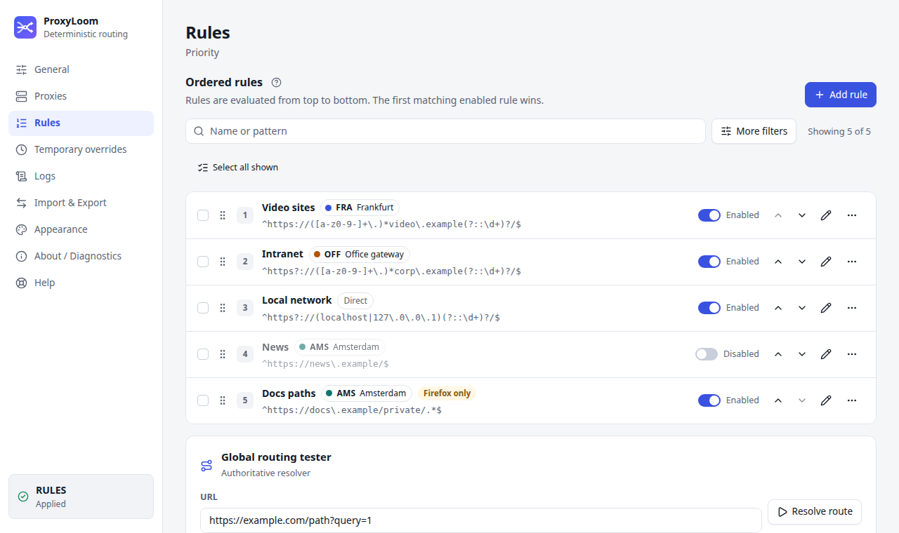
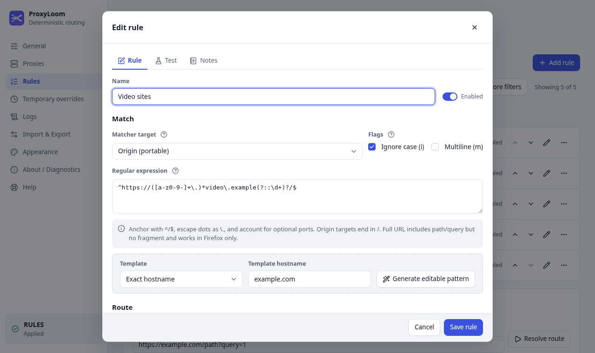
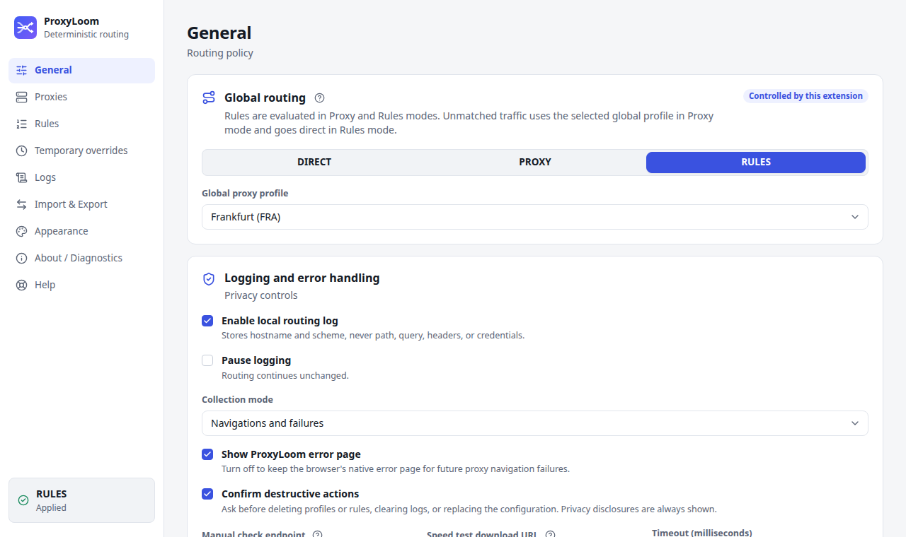
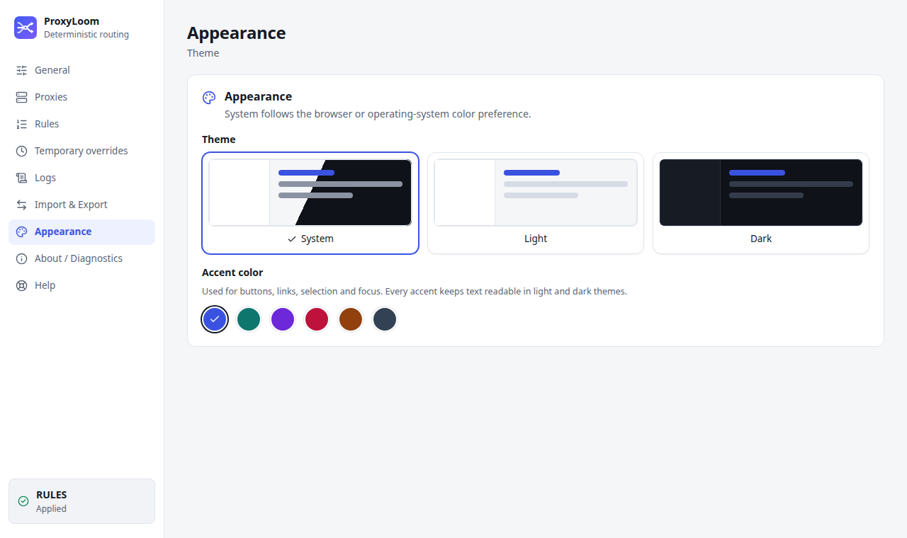
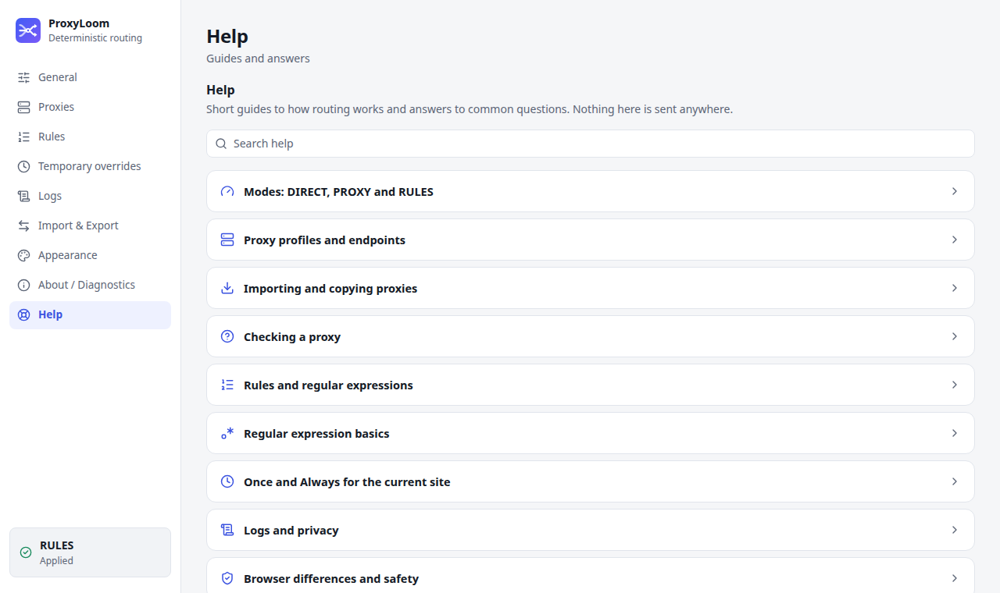
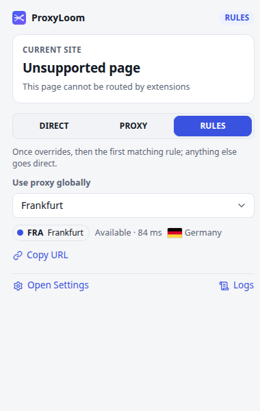

<p align="center">
  
</p>

<h1 align="center">ProxyLoom</h1>

<p align="center">Explicit, deterministic HTTP and HTTPS proxy routing for Chromium browsers and Firefox.</p>

<p align="center">
  <a href="https://github.com/hightemp/ProxyLoom/actions/workflows/ci.yml"></a>
  <a href="https://github.com/hightemp/ProxyLoom/releases/latest"></a>
  <a href="https://github.com/hightemp/ProxyLoom/releases"></a>
  <a href="https://github.com/hightemp/ProxyLoom/commits/main"></a>
  <a href="https://asdertasd.site/counter/ProxyLoom"></a>
</p>
<p align="center">
  
  
  
  
  
  
  
  
</p>

<p align="center"><b>English</b> · <a href="README.ru.md">Русский</a></p>

ProxyLoom is a Manifest V3 browser extension for explicit, deterministic HTTP and HTTPS proxy
routing. One WXT/Vue/TypeScript codebase produces a Chromium package for Chrome, Chromium, Edge,
and Yandex Browser, plus a Firefox MV3 package.

## Routing model

| Mode     | Rule evaluation                           | No matching rule      |
| -------- | ----------------------------------------- | --------------------- |
| `DIRECT` | Rules and temporary overrides are ignored | Direct                |
| `PROXY`  | Temporary override → first matching rule  | Selected global proxy |
| `RULES`  | Temporary override → first matching rule  | Direct                |

An assigned proxy is fail-closed: ProxyLoom never appends a hidden `DIRECT`, system-proxy, or
second-proxy fallback. Recovery requires an explicit user action.

Origin Rules are portable. Full URL Rules, including path and query, run only in Firefox and are
kept visible but skipped in Chromium. HTTP/WS targets use the HTTP endpoint; HTTPS/WSS targets use
the HTTPS endpoint.

## Features

- separate HTTP and HTTPS proxy endpoints, including proxy authentication;
- globally ordered first-match rules with an explicit direct or proxy-profile route, domain-suffix
  templates plus editable Russian-sites and social-network examples, search, filters,
  drag-and-drop and keyboard ordering;
- local regex and full routing testers with no network requests;
- Once/Always site actions with a Temporary overrides list (edit scope and route, make
  permanent, remove) in settings and the popup, and private-session isolation;
- proxy import from pasted text or `.txt`/`.csv` (URI, `host:port`, `user:pass@host:port`,
  `host:port:user:pass`, CSV/TSV, IPv6) with a preview, plus a paste-to-fill profile editor;
- copy a profile as URL, curl command or `host:port:user:pass`, and export the list as text;
- profile search, filters and bulk check/delete; rule bulk enable/disable/delete;
- redacted local routing logs and an optional best-effort main-frame error page with a safe origin
  link;
- inactive-profile checks through the selected proxy, only after an explicit click;
- native JSON merge/replace/export (credentials included by default, opt-out available) and
  profiles-only FoxyProxy 6–9 import;
- one-click proxy check with external IP and country flag, plus an explicit download speed test
  (Mbit/s);
- system/light/dark themes with six accent colors, an in-app Help guide and contextual tips;
- English and Russian UI, chosen by the browser language;
- local-only storage, no analytics, telemetry, accounts, ads, remote config, or remote code.

## Screenshots

Light theme with synthetic demo data. Regenerate them with `pnpm capture:readme-screenshots`
after `pnpm build`.

| Proxies                                                                            | Rules                                              |
| ---------------------------------------------------------------------------------- | -------------------------------------------------- |
|  |  |
| **Rule editor**                                                                    | **Global routing**                                 |
|            |     |
| **Appearance**                                                                     | **Help**                                           |
|                          |             |

<p align="center">
  
</p>

## Development

Requirements: Node 22 or newer and pnpm 10.32.1.

```bash
pnpm install --frozen-lockfile
pnpm dev
pnpm dev:firefox
```

Production builds:

```bash
pnpm build
pnpm build:firefox
pnpm zip
pnpm zip:firefox
pnpm package:artifacts
```

Install unpacked Chromium output from `.output/chrome-mv3`. Firefox development uses
`pnpm dev:firefox`; release candidates are generated in `.output`.

## Verification

```bash
pnpm check
pnpm test:coverage
pnpm test:performance
pnpm test:soak
pnpm test:integration
pnpm test:e2e
pnpm audit
pnpm run licenses
pnpm build
pnpm build:firefox
pnpm validate:build
pnpm scan:artifacts
pnpm zip
pnpm zip:firefox
pnpm package:artifacts
pnpm validate:packages
pnpm validate:source-rebuild
(cd .output && sha256sum ProxyLoom-*.zip > SHA256SUMS)
(cd .output && sha256sum --check SHA256SUMS)
```

All network integration uses loopback origin/proxy fixtures. The Firefox API gate temporarily
installs MV3 test extensions through WebDriver BiDi. Separate headed smokes exercised the final
product builds in official Firefox 153 Stable, Google Chrome 150 Stable, Microsoft Edge 150 Stable
and Yandex Browser 26 Stable. Firefox and Edge include real private routing, memory-only log
isolation and DIRECT restoration; Firefox also includes an MV3 idle-wake check. See the
[browser evidence](docs/research/browser-spikes-2026-07-26.md) and [architecture
decisions](docs/adr/README.md).

## Privacy and browser limits

Credentials are stored in ordinary extension local storage; this is not an encrypted vault.
Exports and copied proxy URLs include credentials in plaintext unless you opt out. Persistent logs contain hostname and scheme, never path,
query, headers, bodies, cookies, or credentials. Private logs remain in memory.

Chromium Once overrides are origin-scoped and may affect other tabs on the same site until the
source tab closes. Firefox can apply reliable tab-scoped overrides. Error-page navigation is best
effort. Read [Privacy](docs/privacy.md), the [User Guide](docs/user-guide/README.md), and
[Known Limitations](docs/user-guide/known-limitations.md).

Store publication and the full signed Chrome/Firefox/Edge/Yandex matrices are intentionally human
release steps; no workflow contains store credentials or publishing actions.

Firefox reviewers can reproduce the submitted package by following
[SOURCE_CODE_REVIEW.md](SOURCE_CODE_REVIEW.md). The release gate rebuilds the extension from the
source ZIP and compares every generated file digest with the tested Firefox output.
