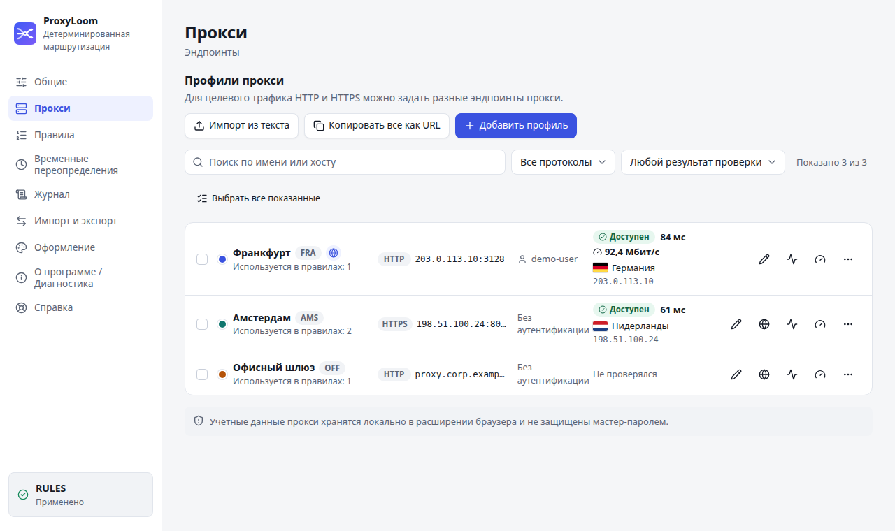
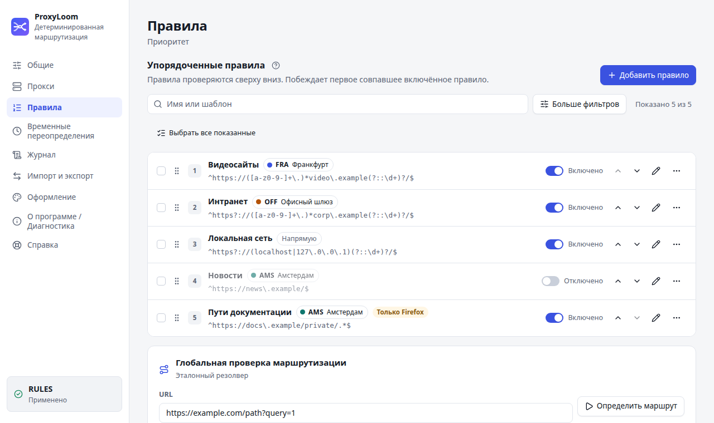
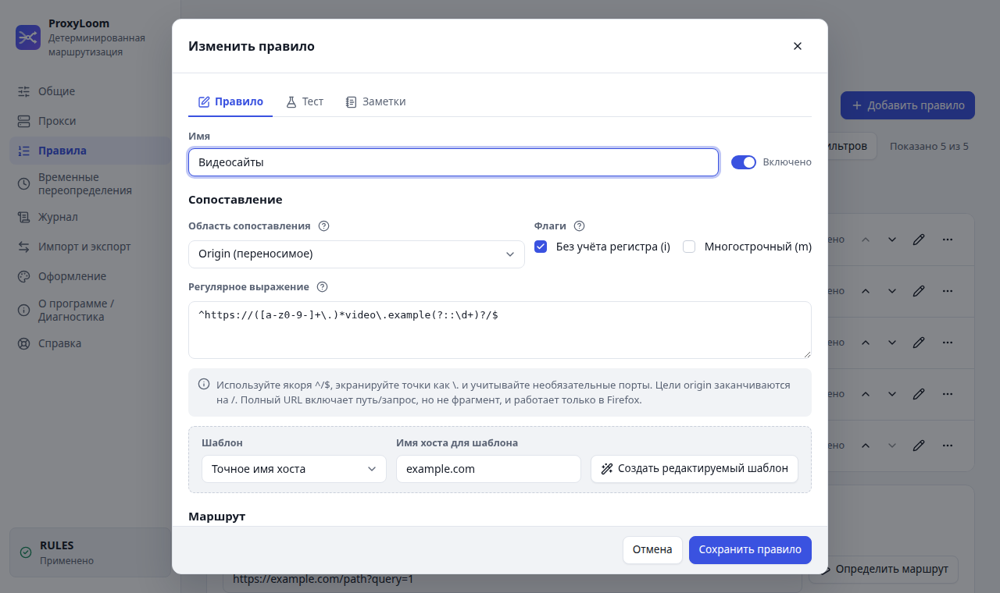
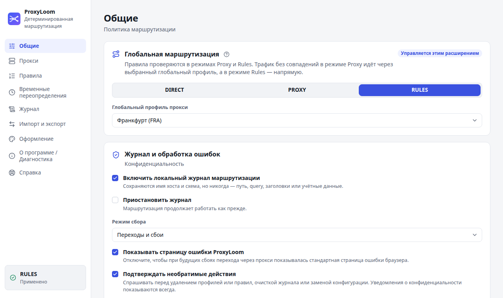
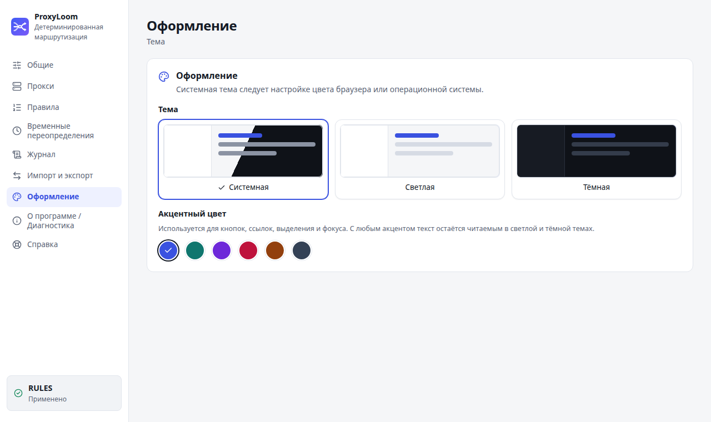
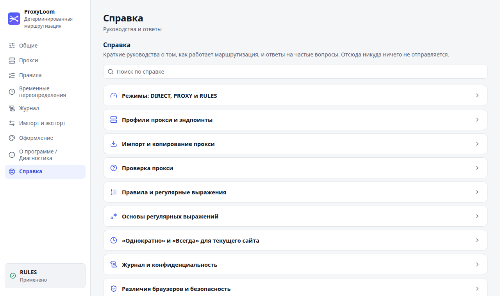

<p align="center">
  
</p>

<h1 align="center">ProxyLoom</h1>

<p align="center">Явная и предсказуемая маршрутизация через HTTP- и HTTPS-прокси для браузеров на Chromium и Firefox.</p>

<p align="center">
  <a href="https://github.com/hightemp/ProxyLoom/actions/workflows/ci.yml"></a>
  <a href="https://github.com/hightemp/ProxyLoom/releases/latest"></a>
  <a href="https://github.com/hightemp/ProxyLoom/releases"></a>
  <a href="https://github.com/hightemp/ProxyLoom/commits/main"></a>
  <a href="https://asdertasd.site/counter/ProxyLoom"></a>
</p>
<p align="center">
  
  
  
  
  
  
  
  
</p>

<p align="center"><a href="README.md">English</a> · <b>Русский</b></p>

ProxyLoom — браузерное расширение Manifest V3 для явной и детерминированной маршрутизации через
HTTP- и HTTPS-прокси. Из одной кодовой базы на WXT/Vue/TypeScript собираются пакет для Chromium
(Chrome, Chromium, Edge и Яндекс Браузер) и пакет Firefox MV3.

## Модель маршрутизации

| Режим    | Проверка правил                                  | Нет подходящего правила     |
| -------- | ------------------------------------------------ | --------------------------- |
| `DIRECT` | Правила и временные переопределения не действуют | Напрямую                    |
| `PROXY`  | Временное переопределение → первое совпавшее     | Выбранный глобальный прокси |
| `RULES`  | Временное переопределение → первое совпавшее     | Напрямую                    |

Назначенный прокси работает по принципу fail-closed: ProxyLoom никогда не добавляет скрытый
запасной вариант `DIRECT`, системный или второй прокси. Восстановление — только явным действием
пользователя.

Правила по origin переносимы между браузерами. Правила по полному URL (с путём и query) работают
только в Firefox; в Chromium они остаются видимыми, но пропускаются. Цели HTTP/WS идут через
HTTP-эндпоинт, HTTPS/WSS — через HTTPS-эндпоинт.

## Возможности

- раздельные эндпоинты прокси для HTTP и HTTPS, включая аутентификацию на прокси;
- глобально упорядоченные правила «первое совпадение побеждает» с явным маршрутом напрямую или
  через профиль, шаблоны по суффиксам доменов, поиск, фильтры, перетаскивание и сортировка с
  клавиатуры;
- локальная проверка регулярных выражений и маршрутизации без сетевых запросов, шпаргалка по
  регулярным выражениям и пояснения к флагам;
- действия «Однократно» и «Всегда» для сайта и список временных переопределений (изменить область
  и маршрут, сделать постоянным, удалить) в настройках и popup, изоляция приватных окон;
- импорт прокси из текста или `.txt`/`.csv` (URI, `host:port`, `user:pass@host:port`,
  `host:port:user:pass`, CSV/TSV, IPv6) с предпросмотром и заполнение профиля из вставленной строки;
- копирование профиля как URL, команды curl или `host:port:user:pass` и экспорт списка в текст;
- проверка прокси одним нажатием с внешним IP и флагом страны и явная проверка скорости
  скачивания (Мбит/с);
- поиск, фильтры и массовые проверка/удаление профилей; массовое включение, отключение и удаление
  правил;
- обезличенный локальный журнал маршрутизации и необязательная страница ошибки для основного фрейма;
- собственный JSON-формат для слияния, замены и экспорта (учётные данные включаются по умолчанию,
  можно отключить) и импорт профилей из FoxyProxy 6–9;
- системная, светлая и тёмная темы с шестью акцентными цветами, встроенная справка и подсказки;
- интерфейс на английском и русском — по языку браузера;
- всё хранится локально: нет аналитики, телеметрии, аккаунтов, рекламы, удалённой конфигурации и
  удалённого кода.

## Скриншоты

Светлая тема, синтетические демо-данные. Переснять: `pnpm build`, затем
`pnpm capture:readme-screenshots`.

| Прокси                                                                                             | Правила                                                          |
| -------------------------------------------------------------------------------------------------- | ---------------------------------------------------------------- |
|           |  |
| **Редактор правила**                                                                               | **Глобальная маршрутизация**                                     |
|  |                    |
| **Оформление**                                                                                     | **Справка**                                                      |
|                                            |                    |

<p align="center">
  
</p>

## Разработка

Требования: Node 22 или новее и pnpm 10.32.1.

```bash
pnpm install --frozen-lockfile
pnpm dev
pnpm dev:firefox
```

Production-сборки:

```bash
pnpm build
pnpm build:firefox
pnpm zip
pnpm zip:firefox
pnpm package:artifacts
```

Распакованную сборку для Chromium устанавливайте из `.output/chrome-mv3`. Для разработки под
Firefox используйте `pnpm dev:firefox`; кандидаты в релиз создаются в `.output`.

## Проверка

```bash
pnpm check
pnpm test:coverage
pnpm test:performance
pnpm test:soak
pnpm test:integration
pnpm test:e2e
pnpm audit
pnpm run licenses
pnpm build
pnpm build:firefox
pnpm validate:build
pnpm scan:artifacts
pnpm zip
pnpm zip:firefox
pnpm package:artifacts
pnpm validate:packages
pnpm validate:source-rebuild
(cd .output && sha256sum ProxyLoom-*.zip > SHA256SUMS)
(cd .output && sha256sum --check SHA256SUMS)
```

Все сетевые интеграционные тесты используют локальные (loopback) origin- и прокси-серверы. Подробнее
— в [результатах проверки в браузерах](docs/research/browser-spikes-2026-07-26.md) и
[архитектурных решениях](docs/adr/README.md).

## Конфиденциальность и ограничения браузеров

Учётные данные хранятся в обычном локальном хранилище расширения; это не зашифрованное хранилище.
Экспорт и скопированные URL прокси содержат учётные данные в открытом виде, если вы не отключили
это. Постоянный журнал содержит только имя хоста и схему — никогда путь, query, заголовки, тело,
cookies или учётные данные. Журнал приватных окон хранится только в памяти.

Проверка прокси и проверка скорости выполняются только по явному нажатию: эндпоинт проверки и сервер
скачивания видят внешний IP прокси, адреса показаны заранее и меняются в настройках.

Переопределения «Однократно» в Chromium действуют на весь origin и могут затронуть другие вкладки
этого сайта, пока исходная вкладка не закрыта. Firefox может ограничить их вкладкой. Страница
ошибки показывается по возможности. См. [Конфиденциальность](docs/privacy.md),
[руководство пользователя](docs/user-guide/README.md) и
[известные ограничения](docs/user-guide/known-limitations.md) (на английском).

Публикация в магазинах и полные подписанные матрицы Chrome/Firefox/Edge/Яндекс — намеренно ручные
шаги релиза; ни один workflow не содержит учётных данных магазинов или действий публикации.

Проверяющие Firefox могут воспроизвести отправленный пакет по инструкции
[SOURCE_CODE_REVIEW.md](SOURCE_CODE_REVIEW.md).
